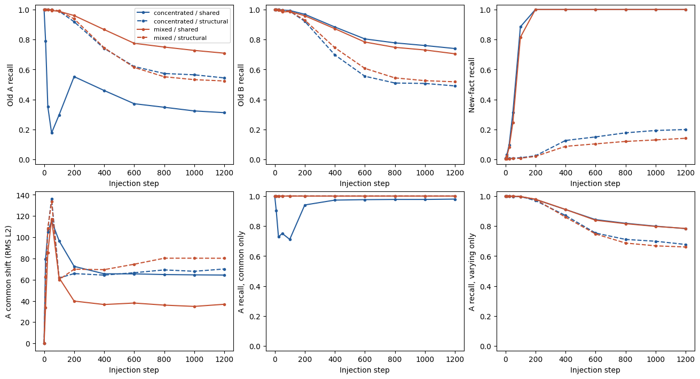
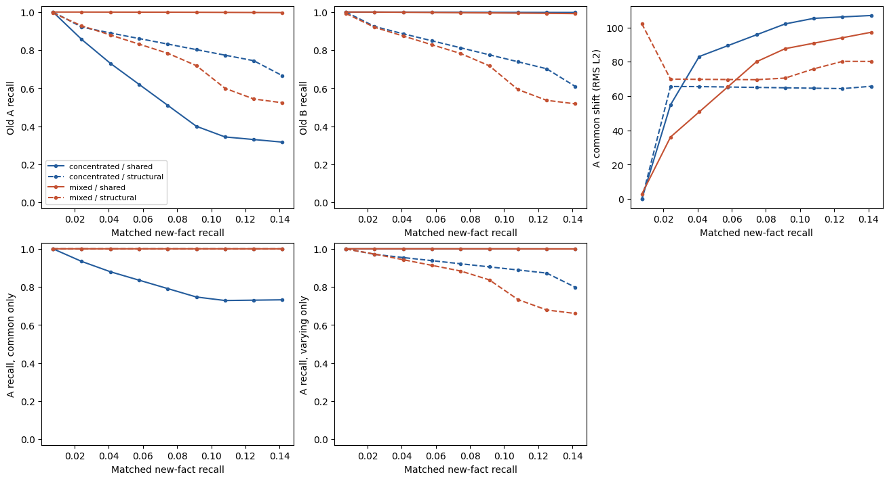

= How biography wording changes spurious forgetting
:toc:

In this Figure 1-scale run, changing new biographies from shared templates to dossier-style entries changed the pattern of forgetting. For concentrated answers, the shared-template arm produced a sharp early collapse in old A recall followed by a partial recovery. The structural arm avoided that early dip. For mixed answers, structural wording instead worsened old A retention. In both answer pools, the structural arms scored much lower on new facts when tested with the original held-out prompts. The experiment therefore shows an effect of the rendering policy on measured retention, with limited evidence about what the models learned in the dossier format itself.

This report uses the saved outputs of one completed GPU run of the link:../biography_wording_forgetting.ipynb[biography wording notebook]. See the link:../biography_wording_forgetting.adoc[experiment guide] for the implementation and function references.

== Experiment and checks

The MLP-free Transformer completed 16,000 pretraining steps and scored 100% first-answer-token recall on both old groups. All four fine-tuning arms started from this checkpoint and ran for 1,200 injection steps.

* Concentrated answers came from the old B answer pool. Mixed answers came from the union of the old A and old B pools. In the saved mixed sample, the share from old A's half ranged from 46.6% to 54.8% across attributes.
* The old and new groups shared zero exact person–attribute–value triples. Within each answer pool, the shared and structural arms had an exact match on all structured facts and used the same person draws and attribute order.
* Evaluation used the original held-out templates in all four arms. The structural renderings averaged about 6.6 fewer nonpadding tokens per biography, and their answer positions averaged about 3.4 tokens earlier. The intervention changed phrasing, template diversity, and token placement together.

== What each arm sees

Take one new person, Ada Morgan Lee, and look at two of her six facts. For this example, suppose the partition puts the year 1912 and the city Paris in old B's answer pools, and London in old A's birthplace pool. These are illustrative assignments. The actual split is seeded and computed separately for each attribute.

In the concentrated pool, Ada's two answers are *1912* and *Paris*, both from old B's pools. In this mixed-pool example, the answers are *1912* and *London*, one from each side. A mixed biography can draw any combination from the two pools.

[cols="1,2,4",options="header"]
|===
|Arm |Facts about Ada |Example text seen during fine-tuning

|Concentrated / shared
|Birth year 1912, birthplace Paris
|The birth year of Ada Morgan Lee is recorded as 1912. The birthplace of Ada Morgan Lee is the city of Paris.

|Concentrated / structural
|Birth year 1912, birthplace Paris
|The birth year of Ada Morgan Lee. 1912. The birthplace of Ada Morgan Lee. Paris.

|Mixed / shared
|Birth year 1912, birthplace London
|The birth year of Ada Morgan Lee is recorded as 1912. The birthplace of Ada Morgan Lee is the city of London.

|Mixed / structural
|Birth year 1912, birthplace London
|The birth year of Ada Morgan Lee. 1912. The birthplace of Ada Morgan Lee. London.
|===

Read down within an answer pool to see the wording change with the facts held fixed. Compare concentrated with mixed at the same wording to see what changing the available answers does. Ada is new in every arm. An answer such as 1912 can be familiar from pretraining while the fact that Ada was born in 1912 is new.

*What the model sees at evaluation.* Both wording arms within a pool get the same original-style held-out prompts. For example, given the prefix “Ada Morgan Lee was born in the year ”, both arms are scored on whether they predict the first token of *1912*. For “Ada Morgan Lee is originally from ”, the target is *Paris* in the concentrated pair and *London* in the mixed pair. These snippets illustrate individual answer slots. In the actual run, the model also receives the preceding biography tokens. Old A and old B are evaluated on their own fixed biographies throughout, and those biographies never enter the fine-tuning batches.

== Recall and shared logit shift over training

_Figure 1. Curves from the saved run. Blue represents concentrated answers and orange represents mixed answers. Solid lines use shared templates and dashed lines use structural renderings. Recall is full-vocabulary first-answer-token accuracy on the fixed original prompts._

[cols="2,1,1,1,1,1",options="header"]
|===
|Arm |Old A trough |Old A final |Old B final |New recall final |Peak common shift

|Concentrated / shared |17.7% |31.2% |74.0% |100.0% |115.5
|Concentrated / structural |54.4% |54.4% |49.1% |20.0% |136.2
|Mixed / shared |70.9% |70.9% |70.5% |100.0% |117.3
|Mixed / structural |52.4% |52.4% |51.8% |14.2% |133.7
|===

Final values are from step 1,200. The shift is the root mean square across attributes of the L2 norm of the mean old A logit change.

* *Concentrated answers.* With shared templates, old A fell from 100% to 17.7%, recovered to about 55% around step 200, and declined to 31.2%. This is the collapse and partial recovery that motivated the extension. Structural wording produced a more gradual decline, ending 23.2 percentage points higher on old A and 24.9 points lower on old B.
* *Mixed answers.* Both arms declined on old A over the run. Structural wording finished 18.5 percentage points lower on old A and 18.7 points lower on old B.
* *New facts.* The two shared-template arms reached 100% on the held-out prompts. The structural arms reached 20.0% and 14.2%. These scores measure transfer to the original evaluation format. The run did not score new facts on held-out dossier-style prompts.

== Comparison at matched new-fact recall

_Figure 2. For each target, each arm is evaluated at its first crossing, with linear interpolation between the adjacent saved evaluations. Curves can therefore compare different training steps and different training exposure counts._

All four arms could be compared between approximately 0.7% and 14.2% new-fact recall. At the top of this range:

[cols="1,1,1,1",options="header"]
|===
|Answer pool |Old A, shared |Old A, structural |Structural minus shared
|Concentrated |about 32% |about 67% |+34.9 percentage points
|Mixed |about 100% |about 52% |−47.3 percentage points
|===

The opposite signs show that the wording effect depends on the answer pool even within this early range of matched recall. The range is narrow, and the interpolated values depend on where each arm crosses a target between saved evaluation steps. The comparison aligns performance on the original prompts and does not establish that the models acquired the same amount of new knowledge in their respective training formats.

== What the representation and logit analyses say

Before fine-tuning, the mean old A–new cosine at the first-answer prediction position fell in every attribute under structural rendering. Across the two answer pools and six attributes, those cosines were about 0.070–0.127 for shared templates and 0.002–0.038 for structural renderings. These are similarities in the pretrained Transformer's final backbone vectors. The run contains no external-encoder results.

The structural arms nonetheless had higher peak common-shift norms in both pools. The norm measures the magnitude of a change across vocabulary logits. Whether that change harms recall depends on which logits move relative to the correct answer.

The notebook tests this by adding the shared per-attribute shift to the original logits and by subtracting it from the fine-tuned logits. In the concentrated/shared arm, the common-only readout has a visible early dip, but it remains well above the observed recall trough. Removing the common shift preserves much of early recall in that arm. The other three common-only curves stay near ceiling even though their observed recall declines. These readouts support a role for the direction of the common shift in the concentrated/shared collapse. They do not assign additive shares of lost accuracy, since first-token accuracy depends on the argmax of the combined logits.

== Conclusion and follow-up

This run shows that input rendering and answer-pool concentration interact. Structural rendering largely removed the characteristic early concentrated-answer dip and changed the trajectory of old B as well. It worsened old A retention under mixed answers. Reduced pre-injection representation overlap accompanied these changes, while the common-shift magnitude alone did not track the recall outcomes.

A direct follow-up is to score new facts on both held-out original prompts and held-out dossier-style prompts for every arm. That would help distinguish limited new-fact acquisition from limited transfer between prompt styles. Additional paired seeds and pretrained checkpoints would establish whether the observed interaction repeats. A more closely matched wording intervention could control answer position and template diversity to isolate which feature of the rendering matters.
